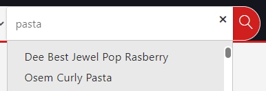

# Pixata.SimilarityChooser [](https://www.nuget.org/packages/Pixata.SimilarityChooser/)

 

A utility that checks for similar items. Useful for when your users don't bother checking to see if the data they want already exists, and add a duplicate. The Similarity Chooser looks through your existing items and lets you know which may match.

SQL Server offers something similar with its free-text search, but this is very limited, and is restricted to known word form variants, such as colour/color and so on. It does not match typos, which makes it fairly useless when dealing with user input.

The similarity chooser uses a Metaphone search, which means it matches words phonetically. This means that if the user entered "humus" it would match "hummous," or one of various other variations. This makes it much more powerful than free-text searches.

>**Version 2.1.0** adds three things...
>- `FindSimilarWithScores()`, which gives each match with a score from 0 to 1 for how close it is, so you can only accept a match that's close enough, or that's clearly closer than the next. See [scores](#scores) (#171)
>- `SimilarEntityChooserOptions.EuropeanCompanyNameWords`, the legal forms of European companies (GmbH, AG, SARL, BV and so on), to use alongside `CompanyNameWords`. See [options](#options) (#169)
>- `CreateMap` no longer has a type parameter of its own, which hid the class's, so `SimilarEntityChooser<string>.CreateMap(products)` compiled and gave you a `SimilarEntityChooser<Product>`. Calls that leave the compiler to work out the type, as all the examples here do, are unchanged. A call that names it, such as `SimilarEntityChooser<Product>.CreateMap<Product>(products)`, needs the second `<Product>` removed (#169)

>**Version 2.0.1** declares the package's MIT licence, which its metadata didn't, so nuget.org and licence scanners show it, and points its repository link at the repository rather than a folder in it (#156). No code changes.

>**Version 2.0.0** changes how names are matched, so that one common word (such as "Ltd") no longer makes two names match. See [breaking changes in v2.0.0](#breaking-changes-in-v200) below.

## Breaking changes in v2.0.0

Previously, a name matched if **any one** of its words sounded like any word of the search text. With company names, that made almost everything match, as every "Ltd" matched every other "Ltd", and words such as "Business" and "Services" did the same. As of v2.0.0...

- **Every word has to match.** A name only matches when every word of the shorter of the name and the search text is close to a word of the longer one. So "Smith Ventures" no longer matches "Advanced Ventures", but "Advance Business Ventures" still matches "Advanced Business Ventures Ltd", and searching for "maple syrup" still finds "Syrup".
- **Words have to be spelt alike as well as sound alike.** The Double Metaphone key only looks at the first few sounds, so "Cavendish" and "Coventry" have the same key. Two words are now only close if, as well as sounding alike, no more than a third of the letters of the longer one need changing to get from one to the other. "Hummous" and "humus" still match.
- **Plurals match.** A word of four or more letters now matches the same word with up to three letters added to the end, so "apple" matches "apples", and "advance" matches "advanced".
- **The closest matches come first.** The results are ordered by how much of the name matched, so searching for "Acme" lists "Acme Ltd" before "Acme Widgets Ltd".
- **Hyphens, slashes and commas separate words.** So "Smith-Jones" is now two words. Other punctuation is still removed, so "O'Brien" is one word.

You can switch the first two off if you want the old behaviour back (see [options](#options) below). `CreateMap` takes the options as a new optional second parameter, so existing calls still compile.

## Set up
Before you can look for matches, you need to set up the chooser. This is done by creating a collection of `MatchingEntityOverview` objects and passing it to the `CreateMap` method...

```c#
SimilarEntityChooser<Product> chooser = SimilarEntityChooser<Product>
  .CreateMap(appDbContext.Products
    .Select(p => new MatchingEntityOverview<Product> {
      ID = p.ProductID,
      MatchText = p.ProductName,
      Entity = p
    }));
```

Once you have the chooser set up, you can query it...

```c#
IEnumerable<Product> syrups = chooser
  .FindSimilar("syrup")
  .Select(meo => meo.Entity);
```

You can then display the choice to your users as you wish.

If you are working in a stateful environment, such as a desktop or Blazor application, where the collection can be held in memory for multiple uses, the code above is fine. However, in a stateless environment, such as a regular web application, you would need to create the map on each request. In that case, you can simplify the code by wrapping it into one call...

```c#
IEnumerable<Product> syrups = SimilarEntityChooser<Product>
  .CreateMap(appDbContext.Products
    .Select(p => new MatchingEntityOverview<Product> { 
      ID = p.ProductID, 
      MatchText = p.ProductName, 
      Entity = p 
    }))
  .FindSimilar("syrup")
  .Select(meo => meo.Entity);
```

## Scores

`FindSimilar()` gives the matches with the closest first, but doesn't say how close they are. That's fine when you show them as a list to pick from, but not when you use the best match to fill something in, such as the supplier on an invoice that your app reads. A wrong supplier is worse than none, so you only want one that's a close match, and clearly closer than the next.

`FindSimilarWithScores()` gives the same matches in the same order, each with a score from 0 to 1...

```c#
List<(MatchingEntityOverview<Supplier> Entity, double Score)> matches = chooser.FindSimilarWithScores(invoice.SupplierName);
bool clearWinner = matches.Count > 0 && matches[0].Score >= 0.75 && (matches.Count == 1 || matches[1].Score < matches[0].Score);
Supplier? supplier = clearWinner ? matches[0].Entity.Entity : null;
```

The score is the number of words in the name and the search text that are close to a word in the other, out of the number of words in both, leaving out the ignored words. So 1 means every word matched, searching for "Acme" scores 1 for "Acme", 0.67 for "Acme Widgets" and 0.5 for "Acme Widgets Direct". With `MatchAllWords` set to `false`, searching for "Müller Bau" scores 1 for "Müller Bau" and 0.5 for "Schmidt Bau", which only shares "Bau". Two names with the same score are as close as each other, such as "Smith Ltd" and "Smyth Ltd" when searching for "Smith" with the company name words ignored.

## Options

You can pass a `SimilarEntityChooserOptions` to `CreateMap` to change how names are matched...

```c#
SimilarEntityChooser<Company> chooser = SimilarEntityChooser<Company>
  .CreateMap(appDbContext.Companies
    .Select(c => new MatchingEntityOverview<Company> {
      ID = c.Id,
      MatchText = c.Name,
      Entity = c
    }), new() {
      IgnoredWords = SimilarEntityChooserOptions.CompanyNameWords
    });
```

| Option | Default | What it does |
| --- | --- | --- |
| `IgnoredWords` | None | Words that are left out of both the names and the search text, as they are too common to tell two names apart. Case, accents and punctuation don't matter, so "ltd." is the same as "Ltd". A name made only of these words keeps them all, so it can still be found |
| `MatchAllWords` | `true` | Whether every word of the shorter of the name and the search text has to match. Set it to `false` to have one matching word be enough, as it was before v2.0.0. The results are still ordered with the closest matches first |
| `RequireCloseSpelling` | `true` | Whether words that sound alike have to be spelt alike as well. Set it to `false` to have sounding alike be enough, as it was before v2.0.0 |

`SimilarEntityChooserOptions.CompanyNameWords` is a ready-made list of words that are common in company names: Ltd, Limited, LLP, PLC, CIC, Inc, LLC, Co, Company, Services, Business, Management, Group, Holdings, Solutions, UK, The, And and Of. With that list, "Smith Services" matches "Smith Ltd". You can add your own...

```c#
new SimilarEntityChooserOptions {
  IgnoredWords = [.. SimilarEntityChooserOptions.CompanyNameWords, "Trading", "International"]
}
```

For European companies, add `SimilarEntityChooserOptions.EuropeanCompanyNameWords`, which has the common legal forms (GmbH, mbH, AG, KG, OHG, GbR, UG, haftungsbeschränkt, eK, Co, SE, SA, SAS, SARL, BV, NV, Srl and SpA) and the German and French words for "and" (und and et). With both lists, "Schmidt Bau GmbH" matches "Schmidt Bau AG", and "Dupont et Fils SARL" matches "Dupont Fils S.A."...

```c#
new SimilarEntityChooserOptions {
  IgnoredWords = [.. SimilarEntityChooserOptions.CompanyNameWords, .. SimilarEntityChooserOptions.EuropeanCompanyNameWords]
}
```

They aren't in `CompanyNameWords`, as some of them are English words (a "Spa" is not always an Italian company). Dots don't matter, so "e.K.", "B.V." and "S.p.A." are left out too, and neither does "&", as punctuation is always left out.

## Limitations
As the matching is done phonetically, the results are not always what the user might expect. For example, on a groceries site where we use this, entering "pasta" brings up an unexpected result...

 

I'm not an expert in linguists, but must of the time I can work out why a match appears, but it can confuse people. Generally, the longer the search text they enter, the better the matches, but there will always be some unexpected results. Version 2.0.0 should give fewer of these, as words now have to be spelt alike as well as sound alike, and every word has to match.

Prior to v2.0.0, the chooser didn't match plurals, so searching for "apple" would not find "apples". It does now.
